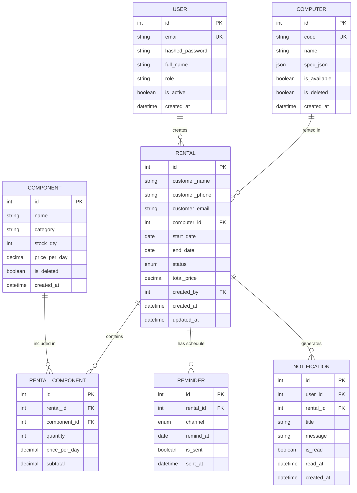

# Architecture Decision Record (ADR-001)

## Rental Computer Management System

### Context
Build a B2B rental management system for a computer rental shop. Internal operators need to track rentals, schedule components, and receive automated reminders before rental expiry.

### Decisions

| Area | Decision | Rationale |
|------|----------|-----------|
| **Backend** | FastAPI + SQLAlchemy 2.0 + Alembic | Async, type-safe, auto OpenAPI, great DX |
| **Frontend** | React 18 + TypeScript + Tailwind + Vite | Modern, fast HMR, component ecosystem |
| **Database** | MySQL 8.0 (Docker) | Familiar, JSONB support, production-ready |
| **ORM** | SQLAlchemy 2.0 (async) | Async IO, 2.0 style, Alembic native |
| **Auth** | JWT (access 30m + refresh 7d), bcrypt | Stateless, scalable, industry standard |
| **Scheduler** | APScheduler (background) | Embedded, cron/interval, persistent jobs |
| **Notifications** | In-app (polling) + Telegram Bot API | Low infra, operator-friendly |
| **Deployment** | Docker Compose (dev/prod parity) | Simple, reproducible, single-file stack |
| **API Docs** | OpenAPI 3.1 (Swagger UI + Redoc) | Contract-first, FE type generation |
| **Timezone** | Asia/Jakarta (UTC+7) | Business timezone |

### Data Model (ERD)

### API Contract (OpenAPI 3.1)
- Base path: `/api/v1`
- Envelope: `{ "data": ..., "meta": {...} }` for lists; `{ "data": ... }` for single
- Errors: `{ "detail": "...", "code": "ERROR_CODE" }` with HTTP status
- Auth: `Authorization: Bearer <access_token>`

### Scheduler Design
- **Daily 08:00**: Query rentals where `end_date IN (today+7, today+3, today+1, today)` AND `status='active'` → create `Notification` + `Reminder` rows → call Telegram `sendMessage`
- **Hourly**: Query `Reminder WHERE is_sent=false AND remind_at <= now()` → send → mark `is_sent=true, sent_at=now()`
- Idempotency: `Reminder.sent_at` guard; `Notification` unique per (user, rental, type)

### Security
- Passwords: bcrypt (cost 12)
- JWT: HS256, short-lived access + rotation refresh
- CORS: Restricted to frontend origin
- Rate limit: 100 req/min per IP (middleware)

### Observability
- Structured logging: `structlog` JSON
- Health: `GET /health` (DB + Redis ping)
- Metrics: Prometheus `/metrics` (optional Sprint 2)

### Future Extensions (Post-MVP)
- Multi-tenant (schema-per-tenant or RLS)
- Role-based access (admin/operator/viewer)
- Email/WhatsApp channels
- Drag-drop calendar (react-big-calendar + dnd)
- Revenue analytics / reporting
- Mobile PWA
