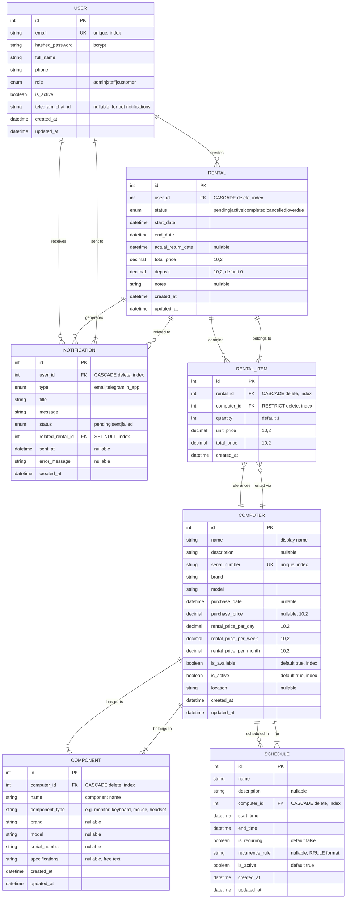

# Entity Relationship Diagram (ERD) — Rental System Database

> **Source of Truth**: This ERD reflects the **actual implemented schema** in `alembic/versions/001_initial_migration.py` and `app/models/__init__.py`.
> Generated: 2024-01-15 | MySQL 8.0 | SQLAlchemy 2.0

---

## Mermaid ER Diagram



---

## Relationship Summary

| Parent | Child | Cardinality | On Delete | Notes |
|--------|-------|-------------|-----------|-------|
| `users` | `rentals` | 1 : N | CASCADE | Operator creates rentals |
| `users` | `notifications` | 1 : N | CASCADE | In-app/Telegram notifications |
| `computers` | `components` | 1 : N | CASCADE | Physical parts of a computer unit |
| `computers` | `rental_items` | 1 : N | RESTRICT | Prevent delete if rented |
| `computers` | `schedules` | 1 : N | CASCADE | Calendar bookings |
| `rentals` | `rental_items` | 1 : N | CASCADE | Line items per rental |
| `rentals` | `notifications` | 1 : N | SET NULL | Link rental to notification |
| `rentals` | `users` | N : 1 | — | `user_id` = operator who created |

---

## Index Strategy

| Table | Index | Columns | Type | Purpose |
|-------|-------|---------|------|---------|
| `users` | `ix_users_email` | `email` | UNIQUE | Login lookup |
| `users` | `ix_users_id` | `id` | BTREE | PK lookup |
| `computers` | `ix_computers_serial_number` | `serial_number` | UNIQUE | Asset tracking |
| `computers` | `ix_computers_brand_model` | `brand, model` | BTREE | Filter by spec |
| `computers` | `ix_computers_available_active` | `is_available, is_active` | BTREE | Available inventory query |
| `components` | `ix_components_computer_type` | `computer_id, component_type` | BTREE | Parts per computer |
| `rentals` | `ix_rentals_user_status` | `user_id, status` | BTREE | Operator's rentals by status |
| `rentals` | `ix_rentals_dates` | `start_date, end_date` | BTREE | Date range queries |
| `rental_items` | `ix_rental_items_rental` | `rental_id` | BTREE | Items per rental |
| `rental_items` | `ix_rental_items_computer` | `computer_id` | BTREE | Computer rental history |
| `notifications` | `ix_notifications_user_status` | `user_id, status` | BTREE | Unread badge query |
| `notifications` | `ix_notifications_created` | `created_at` | BTREE | Time-ordered list |
| `notifications` | `ix_notifications_rental` | `related_rental_id` | BTREE | Notifications per rental |
| `schedules` | `ix_schedules_computer_time` | `computer_id, start_time, end_time` | BTREE | Conflict detection |

---

## Enum Definitions (MySQL)

```sql
-- Users
CREATE TYPE roleenum AS ENUM ('admin', 'staff', 'customer');

-- Rentals
CREATE TYPE rentalstatusenum AS ENUM ('pending', 'active', 'completed', 'cancelled', 'overdue');

-- Notifications
CREATE TYPE notificationtypeenum AS ENUM ('email', 'telegram', 'in_app');
CREATE TYPE notificationstatusenum AS ENUM ('pending', 'sent', 'failed');
```

---

## Key Design Decisions

1. **`rental_items` links to `computers`, not `components`** — A rental rents whole computer units (with their components). Components are tracked as parts of a computer for inventory/detail purposes.

2. **`components` are tied to a `computer` (CASCADE)** — If a computer is deleted, its component records are removed. Components cannot be rented independently in MVP.

3. **`rental_items.computer_id` uses RESTRICT** — Prevents deleting a computer that has rental history (audit trail).

4. **`notifications.related_rental_id` uses SET NULL** — Notification preserved even if rental is deleted (soft delete pattern).

5. **`users.role` default = 'customer'** — MVP only needs `admin`; `staff`/`customer` reserved for future multi-role.

6. **All timestamps use `CURRENT_TIMESTAMP` + `ON UPDATE`** — MySQL-native, no application timezone ambiguity.

6. **Timezone**: Application uses `Asia/Jakarta` (UTC+7); DB stores UTC. Conversion in app layer.

---

## Scheduler-Relevant Queries (EXPLAIN-friendly)

```sql
-- Daily 08:00: Rentals expiring in 1,3,7 days (T-1, T-3, T-7)
SELECT r.*, u.telegram_chat_id, u.email
FROM rentals r
JOIN users u ON r.user_id = u.id
WHERE r.status = 'active'
  AND r.end_date BETWEEN DATE_ADD(CURDATE(), INTERVAL 1 DAY) AND DATE_ADD(CURDATE(), INTERVAL 7 DAY)
  AND DATE(r.end_date) IN (DATE_ADD(CURDATE(), INTERVAL 1 DAY),
                           DATE_ADD(CURDATE(), INTERVAL 3 DAY),
                           DATE_ADD(CURDATE(), INTERVAL 7 DAY));

-- Hourly: Rentals ending today
SELECT r.*, u.telegram_chat_id
FROM rentals r
JOIN users u ON r.user_id = u.id
WHERE r.status = 'active'
  AND DATE(r.end_date) = CURDATE();

-- Overdue check (every 30 min)
SELECT r.id
FROM rentals r
WHERE r.status = 'active'
  AND r.end_date < NOW();
```

> All queries use composite indexes: `ix_rentals_user_status`, `ix_rentals_dates`.